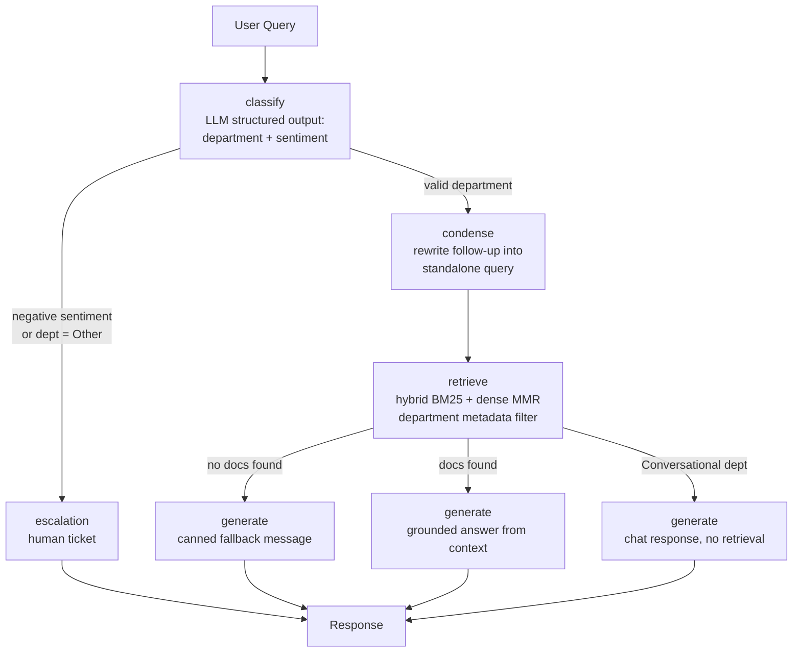

# ShopUNow Agentic Assistant

An **agentic RAG customer-support assistant** built with **LangGraph**, featuring hybrid retrieval (BM25 + dense vector search), sentiment-aware escalation to human agents, and multi-turn conversation memory — wrapped in a Streamlit chat UI.

## 📋 Overview

ShopUNow is an AI support assistant that answers employee and customer questions across four departments — **HR**, **IT Support**, **Billing**, and **Shipping**. Every user query flows through an agentic pipeline that:

1. **Classifies** the query (department + sentiment) using structured LLM output
2. **Condenses** follow-up questions into standalone search queries using conversation history
3. **Retrieves** relevant documentation via hybrid search (BM25 keyword + dense vector MMR, ensembled 50/50) with department metadata filtering
4. **Generates** a grounded answer — or gracefully escalates to a human agent when needed

Negative sentiment, out-of-scope topics, or queries with no matching documentation trigger an **escalation flow** with a human ticket form in the UI.

## ✨ Features

- 🧠 **Agentic RAG pipeline** — LangGraph `StateGraph` with four specialized nodes
- 🔀 **Hybrid retrieval** — `EnsembleRetriever` combining BM25 (sparse keyword) and Chroma dense vectors with MMR, weighted 50/50
- 🏷️ **Department-aware filtering** — retrieval restricted to the classified department's documents via Chroma metadata filters
- 💬 **Contextual query condensation** — rewrites follow-ups like *"how many hours does my manager have to review it?"* into standalone queries using chat history
- 😟 **Sentiment-based escalation** — negative sentiment or unrecognized departments route to a human support ticket
- 🙋 **Human-in-the-loop escalation form** — Streamlit form capturing name, email, phone, and issue summary (24-business-hour SLA)
- 🧵 **Thread-persistent memory** — `MemorySaver` checkpointer scoped by `thread_id` for multi-turn conversations
- 🤖 **Synthetic data generation** — GPT-4o-mini generates a 48-pair FAQ dataset across 4 departments via structured output
- 🎭 **Conversational mode** — handles greetings and meta-questions ("What was my last query?") without retrieval

## 🏗️ Architecture



### LangGraph Nodes

| Node | Responsibility |
|------|----------------|
| `classify` | Classifies sentiment (`positive`/`neutral`/`negative`) and department (`HR`, `IT_Support`, `Billing`, `Shipping`, `Conversational`, `Other`) via `llm.with_structured_output`. Escalates on negative sentiment or unsupported departments. |
| `condense` | Rewrites multi-turn follow-ups into standalone search queries using conversation history; strips personal/meta questions. Skipped when escalating. |
| `retrieve` | Ensembles dense MMR retrieval (`k=5`, department metadata filter) with BM25 (`k=5`) at 50/50 weights, then post-filters by exact department match. Returns `NO_DOCS_FOUND` or `CONVERSATIONAL_RESPONSE` sentinels when applicable. |
| `generate` | Produces the final answer: escalation message, conversational reply, canned fallback, or grounded QA response over retrieved context. |

## 🛠️ Tech Stack

| Component | Technology |
|-----------|------------|
| Agent orchestration | [LangGraph](https://github.com/langchain-ai/langgraph) (>=1.2.14) |
| LLM | OpenAI `gpt-4o` (agent, temp=0) · `gpt-4o-mini` (data generation, temp=0.7) |
| Embeddings | OpenAI `text-embedding-3-small` |
| Vector store | [ChromaDB](https://github.com/chroma-core/chroma) (persistent, local) |
| Sparse retrieval | [rank-bm25](https://github.com/dorianbrown/rank_bm25) via `BM25Retriever` |
| Hybrid search | LangChain `EnsembleRetriever` |
| UI | [Streamlit](https://streamlit.io) (>=1.65.0) |
| Package manager | [uv](https://github.com/astral-sh/uv) |

## 📦 Prerequisites

- **Python >= 3.11**
- **[uv](https://docs.astral.sh/uv/getting-started/installation/)** package manager
- **OpenAI API key**

## 🚀 Setup & Installation

1. **Clone the repository and install dependencies:**

   ```bash
   uv sync
   ```

2. **Create a `.env` file in the project root with your OpenAI API key:**

   ```env
   OPENAI_API_KEY=sk-...
   ```

## 📊 Data Pipeline

The knowledge base is built in two steps:

1. **Generate the synthetic FAQ dataset** (48 Q&A pairs across HR, IT Support, Billing, and Shipping using GPT-4o-mini):

   ```bash
   python generate_data.py
   ```

   → produces `data/faqs.json`

2. **Ingest the FAQs into ChromaDB** (embeds documents with `text-embedding-3-small` and runs a metadata-filtering smoke test):

   ```bash
   python ingest.py
   ```

   → creates the persistent `chroma_db/` directory with collection `shopunow_faqs`

## ▶️ Running the App

```bash
streamlit run app.py
```

Then open the app in your browser and start chatting. Use the sidebar to:

- View your current **thread ID** (conversation memory scope)
- **Reset the conversation**
- See the list of supported departments

If the assistant detects negative sentiment or can't find relevant documentation, an **escalation form** appears to submit a human support ticket.

### CLI Testing (optional)

`agent.py` includes a multi-turn test harness you can run directly:

```bash
python agent.py
```

## 📁 Project Structure

```
shopunow-agentic-assistant/
├── agent.py            # LangGraph agent: classify → condense → retrieve → generate
├── app.py              # Streamlit chat UI with escalation form
├── generate_data.py    # Synthetic FAQ generation (GPT-4o-mini structured output)
├── ingest.py           # ChromaDB ingestion + metadata filtering smoke test
├── main.py             # uv-generated placeholder entry point
├── pyproject.toml      # Project metadata and dependencies
├── README.md
├── chroma_db/          # Persistent Chroma vector store (generated)
└── data/
    └── faqs.json       # Synthetic FAQ dataset (generated)
```

## 🔧 Configuration

Key constants in `agent.py`:

| Constant | Value | Description |
|----------|-------|-------------|
| `PERSIST_DIRECTORY` | `./chroma_db` | Chroma persistence path |
| `COLLECTION_NAME` | `shopunow_faqs` | Chroma collection name |
| `ALLOWED_DEPARTMENTS` | `HR`, `IT_Support`, `Billing`, `Shipping`, `Conversational` | Departments the agent can route to |

## 📝 Notes

- Conversation memory is in-process (`MemorySaver`) — resetting the app or changing the thread ID starts a fresh conversation.
- The BM25 index is built at import time from the documents already stored in Chroma, so `ingest.py` must run before starting the app.
- The FAQ dataset is fully synthetic — replace `generate_data.py` with your own data source to use real documentation.